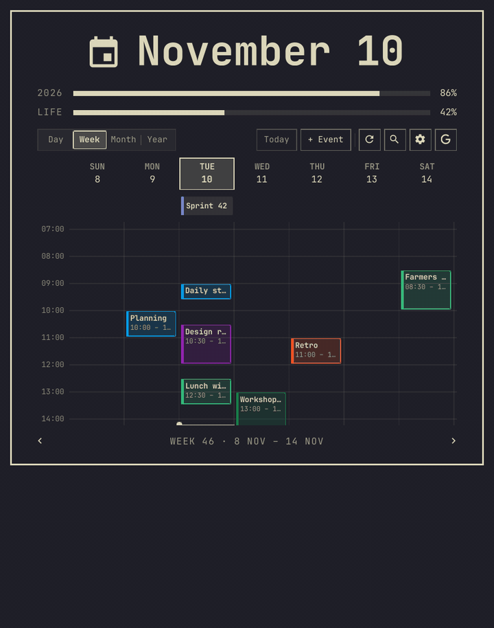
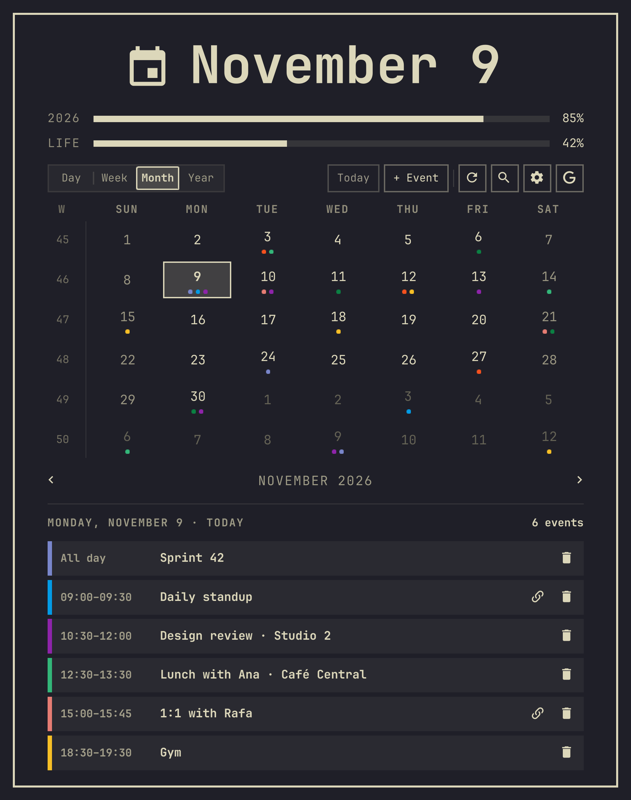
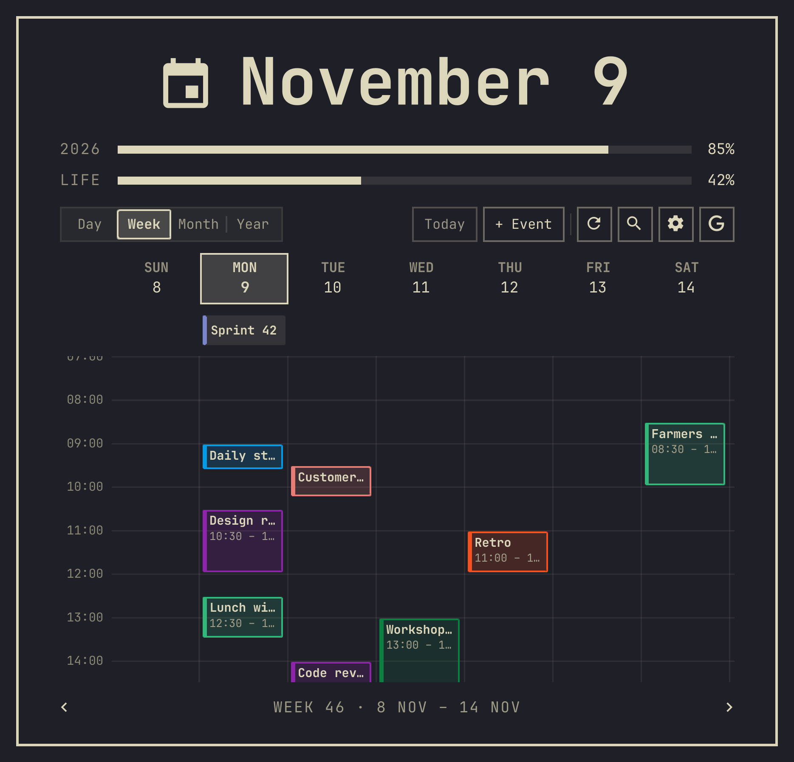
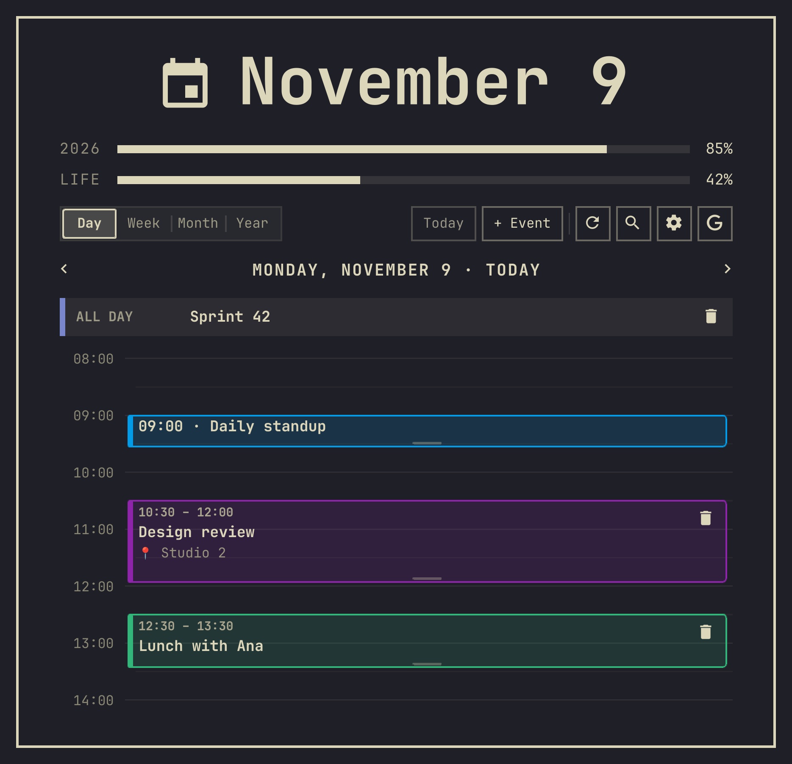
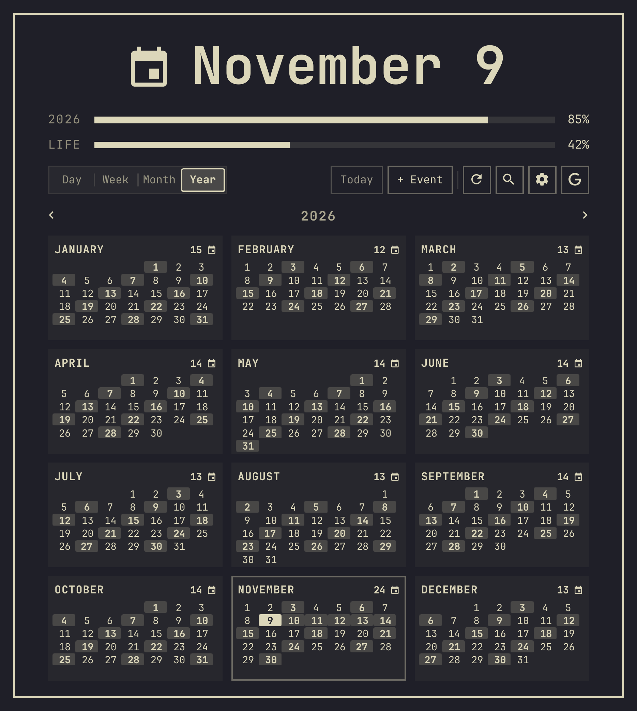
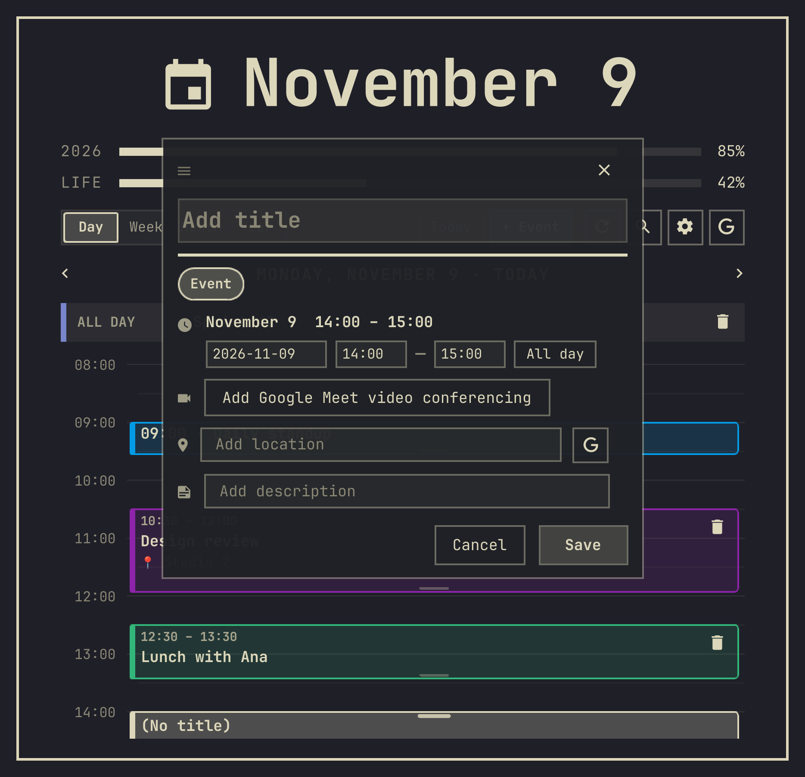

# Calendar for Google

**🇺🇸 English** · [🇧🇷 Português (Brasil)](README.pt-BR.md)

A bar clock for [Omarchy](https://omarchy.org) whose popup is a full agenda: Day, Week,
Month and Year views of your Google Calendar, with event creation, drag to reschedule,
search, Meet links and a reminder before each meeting. It is a clone of Omarchy's stock
clock, so it sits in the same place, keeps the year and life progress bars, and answers
the stock calendar shortcut (`Super + Ctrl + Alt + D`).

Not affiliated with Google. Google Calendar is a trademark of Google LLC.

<p align="center">
  
</p>
<p align="center">
  
  
</p>
<p align="center">
  
  
</p>
<p align="center">
  
</p>

*All screenshots and the GIF are rendered by the dev harness from made-up events (see
Development).*

## Features

- **Two ways to sync:** a secret iCal (.ics) address (read-only, 30 seconds to set up) or
  Google OAuth2 (two-way: events you create, move or delete in Omarchy go to Google).
  Without either, it works as a local agenda.
- **Four views:** Day and Week on a proportional time grid with a "now" line, Month with
  event dots and the selected day's agenda, Year with event density per day.
- **Create and edit in place:** drag on the Day or Week grid (15-minute snap) or press `N`;
  drag an event's edges to change its time, drag it to another day to move it. Optional
  Google Meet link, location suggestions with a map preview, description.
- **Search** (`/`) across all synced events.
- **Reminders:** a desktop notification a few minutes before each meeting (with a button
  that opens the Meet link), and optionally the next event next to the clock.
- **Keyboard driven**, follows the Omarchy theme and language (English, Portuguese).
- **No dependencies to install:** the sync helper (`omarchy-gcal`) is plain Python 3
  standard library.

<p align="center">
  
  
</p>

## Install

```bash
omarchy plugin add https://github.com/gusthanks/omarchy-google-calendar.git --enable
```

When asked where to place it in the bar, pick `center` (instead of the stock clock).
Then click the clock and press `S` to connect your calendar.

### Upgrading from 1.2 or earlier (plugin id `gusthx.clock`)

In 1.3.0 the plugin id changed from `gusthx.clock` to `gusthx.google-calendar`, so
`omarchy plugin update` cannot carry an existing install over by itself. Run the
migration once from a fresh clone, then restart the shell:

```bash
git clone https://github.com/gusthanks/omarchy-google-calendar.git ~/omarchy-google-calendar
~/omarchy-google-calendar/dev/migrate-id.sh   # DRY_RUN=1 first to see what it would do
omarchy restart shell
```

It backs up the old folder to `~/.local/state/omarchy/plugin-backups/` (set
`BACKUP_DIR` to change it), installs `gusthx.google-calendar` as a git checkout, renames
the widget's entry in `~/.config/omarchy/shell.json` (its settings and place in the bar
are kept), repoints `~/.local/bin/omarchy-gcal` and removes the old folder. It is safe
to run twice. Your calendar config, tokens and cache do not depend on the id and are not
touched. Afterwards the clone can be deleted.

## Connect Google Calendar

| | Option 1: secret iCal address (.ics) | Option 2: Google Cloud OAuth2 |
|---|---|---|
| **Setup time** | ~30 seconds | ~3–5 minutes (once) |
| **Sync direction** | One-way (Google ➔ Omarchy) | Two-way (Google ⇄ Omarchy) |
| **New events** | Saved locally in Omarchy | Sent to Google (phone, web) |
| **Google Cloud project** | None | A free one, created by you |

**Option 1, secret iCal address.** In [Google Calendar on the web](https://calendar.google.com/),
open your calendar's **Settings and sharing**, copy **"Secret address in iCal format"**
(not the public one), then click the clock, press `S`, paste it and press **Save & Sync**.

**Option 2, OAuth2.** Create a free Google Cloud project, enable the Calendar API, add
yourself as a test user, create a **Desktop app** OAuth client and download its JSON to
`~/Downloads`. Then run:

```bash
omarchy-gcal auth
```

It picks up the newest `client_secret_*.json` in `~/Downloads`, opens the browser to
sign in, and keeps the token refreshed from then on.

**Step-by-step guide with every screen:** [docs/sync-guide.md](docs/sync-guide.md)
([português](docs/sync-guide.pt-BR.md)).

## Keyboard shortcuts

| Shortcut | Description |
|---|---|
| `1`–`4` or `d` / `w` / `m` / `y` | Switch to **Day**, **Week**, **Month**, **Year** view |
| `v` / `V` | Cycle to the next / previous view |
| `[` / `]` or `h` / `l` | Move backward / forward by one day, week, month or year (the open view) |
| `k` / `j` | Move up / down: by week (Day view), by month (Week view), by year (Month and Year views) |
| `{` / `}` | Move backward / forward by one year |
| `/` | Open **Search events** drawer to live-filter agenda |
| `T` | Jump back to **Today** |
| `N` or `+` | Open **+ Event** quick creation drawer |
| `R` | Force immediate refresh / synchronization |
| `S` | Toggle Google Calendar sync settings drawer |
| `W` | Switch to Week view; in Week view, toggle the week start (Monday / Sunday) |
| `Esc` | Close active drawer or calendar panel |

## Command line

The backend engine can also be queried directly from your shell or scripts:

```bash
# Check sync status and event count
omarchy-gcal status

# List upcoming events or filter by date
omarchy-gcal list --upcoming
omarchy-gcal list --date today
omarchy-gcal list --date tomorrow

# Search events by keyword
omarchy-gcal list -q "Standup"

# Force sync
omarchy-gcal sync

# Add an event from command line
omarchy-gcal add --title "Team Meeting" --date 2026-11-10 --start 14:00 --end 15:00 --location "Google Meet"
```

## Configuration

The widget reads these optional keys from its entry in the bar layout
(`~/.config/omarchy/shell.json`, the same place as the stock clock's settings):

| Key | Default | What it does |
|---|---|---|
| `format` / `formatAlt` | `dddd dd MMM h:mm AP` / `d MMMM 'W'ww yyyy` | Clock formats (right-click cycles through presets) |
| `verticalFormat` / `verticalFormatAlt` | `HH\n—\nmm` / … | Formats for a vertical bar |
| `defaultViewMode` | `month` | `day`, `week`, `month` or `year` |
| `weekStartDay` | your locale | `monday`, `sunday`, … (`W` in Week view toggles it) |
| `autoSync` | `true` | Sync in the background |
| `syncIntervalMinutes` | `10` | How often |
| `showBarEventBadge` | `false` | Show the next event next to the clock |
| `notificationsEnabled` | `true` | Reminder notifications |
| `notifyBeforeMinutes` | `10` | How long before a meeting |
| `birthYear`, `lifeExpectancy` | unset, `90` | The LIFE progress bar (also editable in the panel) |
| `gcalBinPath` | the bundled `omarchy-gcal` | Use another helper binary |

The helper keeps its own settings in `~/.config/omarchy/gcal/config.json` (iCal
addresses, OAuth client) and its cache in `~/.local/state/omarchy/gcal/`.
`OMARCHY_GCAL_CONFIG_DIR` and `OMARCHY_GCAL_STATE_DIR` move them.

## Privacy

Everything stays on your machine except the requests below; there is no telemetry.

**What it stores** (files are created `0600`, folders `0700`):
- `~/.config/omarchy/gcal/config.json`: your secret iCal address(es) and, if you paste
  them, your OAuth client ID and secret.
- `~/.config/omarchy/gcal/credentials.json` and `token.json`: the OAuth client file and
  the access/refresh token.
- `~/.local/state/omarchy/gcal/events.json`: the synced events (about two years back and
  one forward), read by the bar widget. It also holds a copy of your secret iCal
  address(es) for the settings field, so treat it like `config.json` and don't share it
  when reporting a bug. `local_events.json`: events created offline.
- `~/.local/bin/omarchy-gcal`: a symlink to the helper so you can use it in a terminal.
  It is only created when nothing is there.

**What it reads:** besides the files above, `omarchy-gcal auth` looks in `~/Downloads`
for a `client_secret_*.json` file (the one Google Cloud just gave you) and copies the
newest one to `credentials.json`.

**Hosts it contacts:**
- `www.googleapis.com` and `oauth2.googleapis.com`: the Calendar API and token refresh
  (OAuth2 mode only). Sign-in opens `accounts.google.com` in your browser, with a
  one-time callback on `127.0.0.1`.
- The iCal address(es) you configured (usually `calendar.google.com`), over HTTPS only.
- `photon.komoot.io`, then `nominatim.openstreetmap.org` as a fallback: the text you type
  in an event's **location** field, for address suggestions (only while you type there).
- `basemaps.cartocdn.com`: map tiles for the small map shown after picking a suggested
  location.
- Links you click (Meet, Google Maps, the event on Google Calendar) open in your browser.

The secret iCal address is never printed: `omarchy-gcal status` and sync errors show
only its host.


## Global shortcut and IPC

The manifest declares the plugin a clone of the stock clock
(`"omarchy": { "clonedFrom": "omarchy.clock" }`), so anything that opens the stock clock
opens this panel instead, including Omarchy's default **`Super + Ctrl + Alt + D`**
binding (`omarchy-shell shell toggle omarchy.clock`).

The widget also answers IPC calls addressed to the stock clock, so scripts written for
it keep working. These targets all take the same methods:

| Target | Why |
|---|---|
| `gusthx.google-calendar` | The plugin's own id |
| `omarchy.clock` | Compatibility with the stock clock and its shortcuts |
| `omarchy-google-calendar` | The plugin id in 1.0, kept for old scripts |

Methods: `toggle`, `open` / `show`, `close` / `hide`, `setViewMode <day|week|month|year>`,
`syncCalendar`, `refresh`, `cycleFormat`, `toggleWeekStart`. For example:

```bash
omarchy-shell gusthx.google-calendar setViewMode week
omarchy-shell omarchy.clock syncCalendar
```

Keep only one clock in the bar: with both the stock clock and this widget placed, both
would claim the `omarchy.clock` target.

## Development

Never develop on the installed copy (`~/.config/omarchy/plugins/gusthx.google-calendar`):
saving there hot-reloads your bar. Work in a clone and use the isolated harness in `dev/`.
It runs its own Quickshell instance with Omarchy's `Commons`/`Ui` libraries, made-up
events and a stub helper, so it never touches your bar, calendar, tokens or config.

```bash
dev/run.sh check      # compile every QML type (Panel and BarWidget included)
dev/run.sh docs       # render all screenshots and the GIF in docs/ (offscreen, nothing on screen)
dev/run.sh panel week # just one view
dev/run.sh gif        # just docs/demo.gif (needs ffmpeg)
dev/run.sh preview    # a window with the panel, to click around in
dev/test.sh           # unit tests: helper (Python) and Model.js (node)
omarchy plugin validate .
```

When everything is committed, install it once and restart the shell once:

```bash
dev/deploy.sh   # validates, checks, tests, updates the installed plugin, restarts the shell
```

If the installed plugin is a plain copy, `deploy.sh` backs it up to
`~/.local/state/omarchy/plugin-backups/gusthx.google-calendar.<timestamp>` and replaces
it with a git checkout of this repo. It refuses to run while an install under the old id `gusthx.clock` exists:
run `dev/migrate-id.sh` first. See [AGENTS.md](AGENTS.md) for the rules AI agents follow
here, and [CHANGELOG.md](CHANGELOG.md) for what changed.

## Credits

- Built on [Omarchy](https://github.com/basecamp/omarchy) by David Heinemeier Hansson and
  contributors: the bar widget started as a clone of Omarchy's stock clock
  (`omarchy.clock`, MIT), whose clock formats, year and life progress bars and IPC
  methods it keeps.
- Location suggestions by [Photon](https://photon.komoot.io/) and
  [Nominatim](https://nominatim.openstreetmap.org/) (OpenStreetMap data, © OpenStreetMap
  contributors); map tiles by [CARTO](https://carto.com/).
- Google Calendar and Google Meet are trademarks of Google LLC. This project is not
  affiliated with or endorsed by Google.

## License

[MIT](LICENSE) © 2026 Gustavo Costa (gusthx). Portions © David Heinemeier Hansson
(Omarchy).
