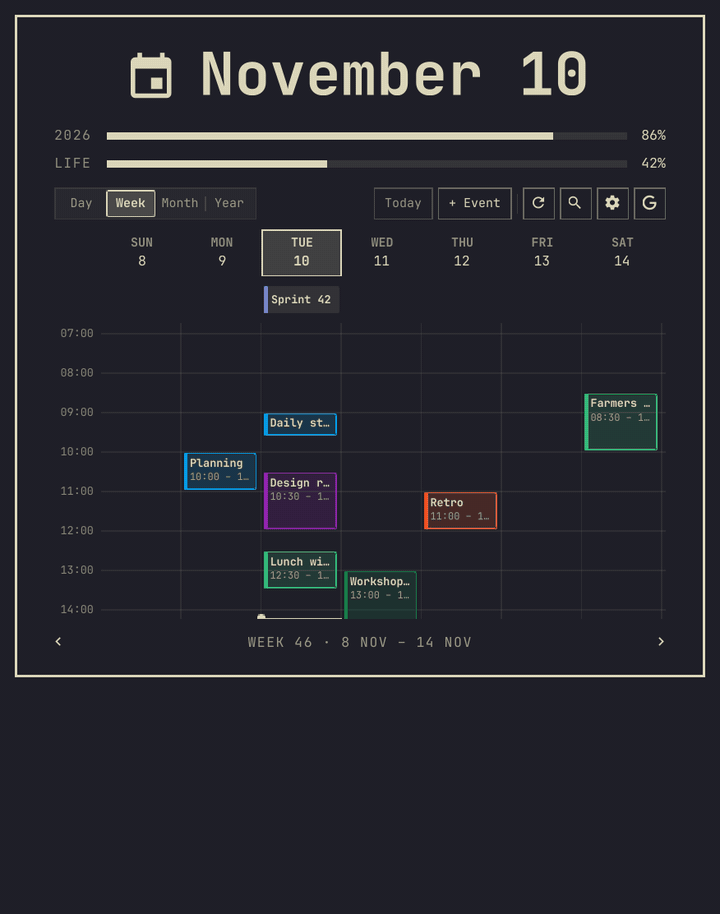
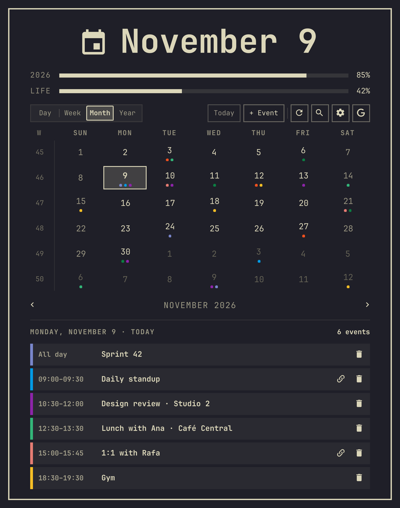
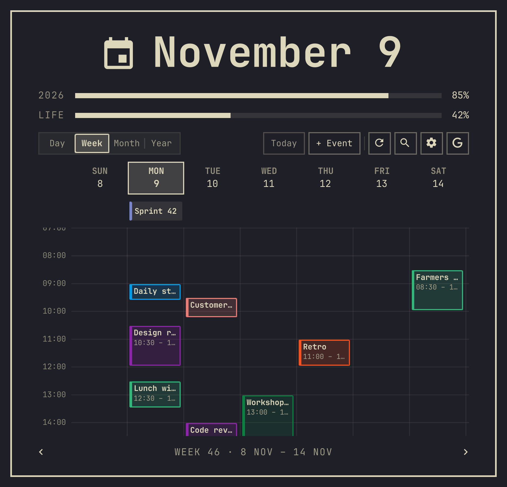
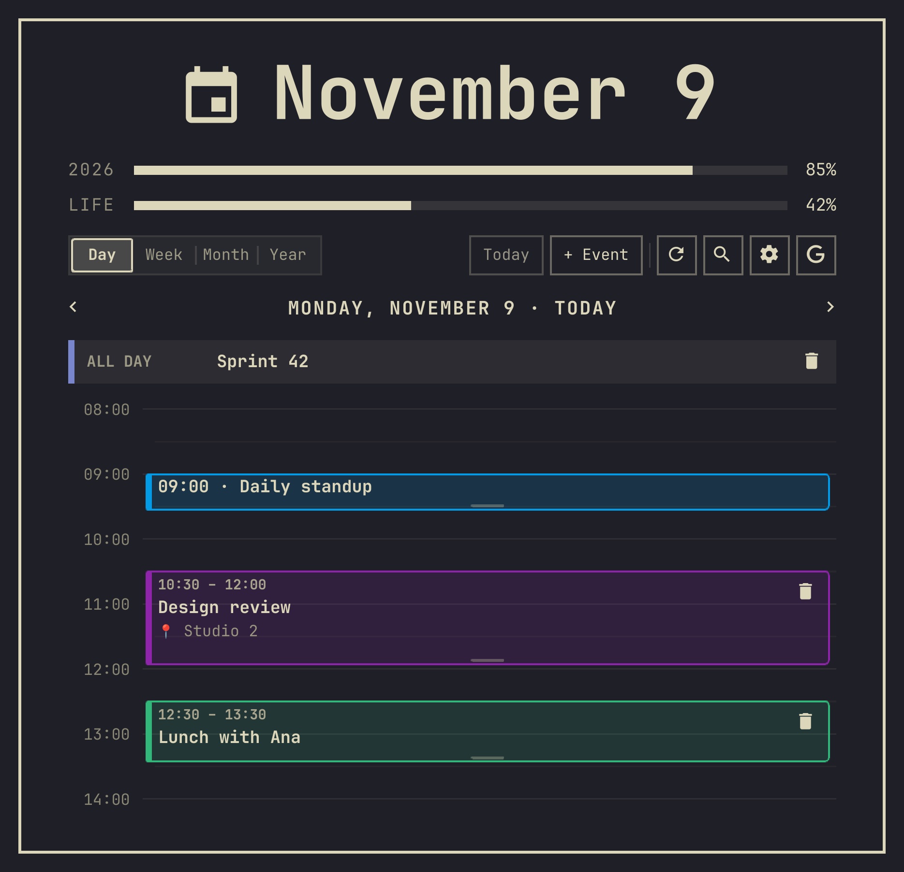
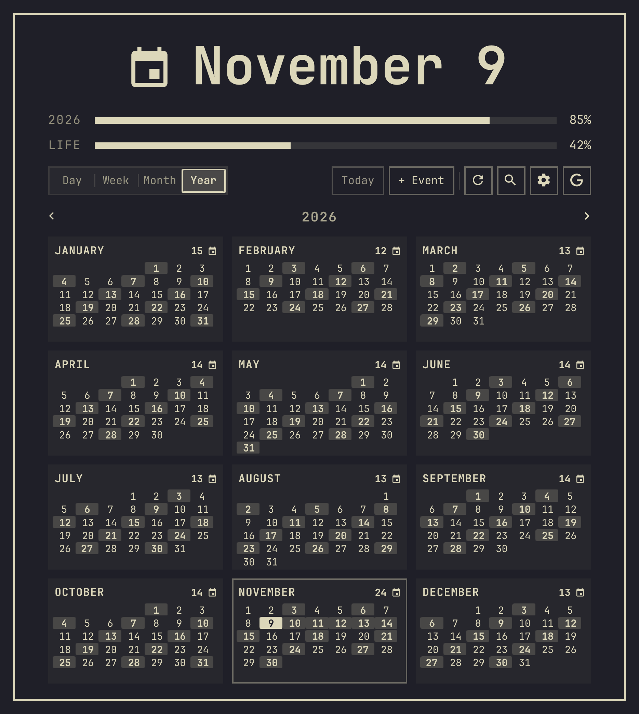
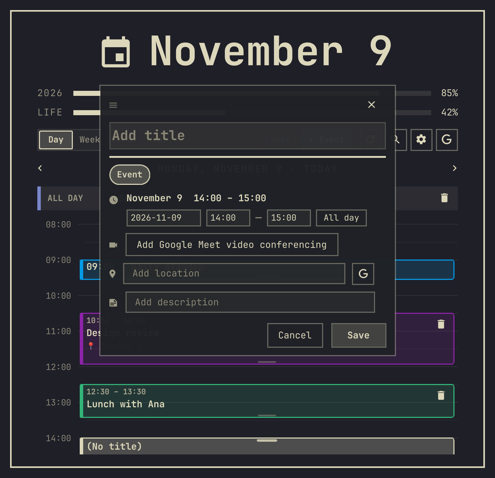

# Calendar for Google

[🇺🇸 English](README.md) · **🇧🇷 Português (Brasil)**

Um relógio de barra para o [Omarchy](https://omarchy.org) cujo popup é uma agenda
completa: visões Dia, Semana, Mês e Ano do seu Google Calendar, com criação de eventos,
arrastar para remarcar, busca, links do Meet e um lembrete antes de cada reunião. É um
clone do relógio padrão do Omarchy: fica no mesmo lugar, mantém as barras de progresso
do ano e da vida e responde ao atalho padrão do calendário (`Super + Ctrl + Alt + D`).

Não é afiliado ao Google. Google Calendar é uma marca do Google LLC.

<p align="center">
  
</p>
<p align="center">
  
  
</p>
<p align="center">
  
  
</p>
<p align="center">
  
</p>

*Todas as capturas e o GIF são gerados pelo harness de desenvolvimento a partir de
eventos inventados (veja Desenvolvimento). As capturas estão com a interface em inglês.*

## Recursos

- **Duas formas de sincronizar:** um endereço iCal (.ics) secreto (só leitura, 30
  segundos para configurar) ou OAuth2 do Google (bidirecional: o que você cria, move ou
  apaga no Omarchy vai para o Google). Sem nenhum dos dois, funciona como agenda local.
- **Quatro visões:** Dia e Semana numa grade de horários proporcional com a linha do
  "agora", Mês com pontos de eventos e a agenda do dia selecionado, Ano com a densidade
  de eventos por dia.
- **Criar e editar no lugar:** arraste na grade do Dia ou da Semana (encaixe de 15
  minutos) ou pressione `N`; arraste as bordas de um evento para mudar o horário, ou o
  evento inteiro para outro dia. Link do Google Meet opcional, sugestões de local com
  prévia do mapa, descrição.
- **Busca** (`/`) em todos os eventos sincronizados.
- **Lembretes:** uma notificação alguns minutos antes de cada reunião (com um botão que
  abre o link do Meet) e, se quiser, o próximo evento ao lado do relógio.
- **Feito para o teclado**, segue o tema e o idioma do Omarchy (inglês, português).
- **Nada para instalar:** o helper de sincronização (`omarchy-gcal`) usa só a biblioteca
  padrão do Python 3.

<p align="center">
  
  
</p>

## Instalação

```bash
omarchy plugin add https://github.com/gusthanks/omarchy-google-calendar.git --enable
```

Quando perguntar onde colocar na barra, escolha `center` (no lugar do relógio padrão).
Depois clique no relógio e pressione `S` para conectar sua agenda.

### Atualizando da 1.2 ou anterior (id `gusthx.clock`)

Na 1.3.0 o id do plugin mudou de `gusthx.clock` para `gusthx.google-calendar`, então o
`omarchy plugin update` não consegue levar uma instalação existente sozinho. Rode a
migração uma vez a partir de um clone novo e reinicie o shell:

```bash
git clone https://github.com/gusthanks/omarchy-google-calendar.git ~/omarchy-google-calendar
~/omarchy-google-calendar/dev/migrate-id.sh   # antes, DRY_RUN=1 mostra o que faria
omarchy restart shell
```

O script faz backup da pasta antiga em `~/.local/state/omarchy/plugin-backups/` (a
variável `BACKUP_DIR` muda o lugar), instala `gusthx.google-calendar` como um checkout
git, renomeia a entrada do widget em `~/.config/omarchy/shell.json` (mantendo as
configurações e o lugar na barra), aponta `~/.local/bin/omarchy-gcal` para o novo caminho
e remove a pasta antiga. Pode ser rodado duas vezes sem problema. A configuração da
agenda, os tokens e o cache não dependem do id e não são tocados. Depois, o clone pode
ser apagado.

## Conectar o Google Calendar

| | Opção 1: endereço iCal secreto (.ics) | Opção 2: OAuth2 do Google Cloud |
|---|---|---|
| **Configuração** | ~30 segundos | ~3–5 minutos (uma vez) |
| **Direção** | Unidirecional (Google ➔ Omarchy) | Bidirecional (Google ⇄ Omarchy) |
| **Novos eventos** | Salvos localmente no Omarchy | Enviados ao Google (celular, web) |
| **Projeto no Google Cloud** | Nenhum | Um gratuito, criado por você |

**Opção 1, endereço iCal secreto.** No [Google Agenda na web](https://calendar.google.com/),
abra **Configurações e compartilhamento** da sua agenda, copie o **"Endereço secreto em
formato iCal"** (não o público), clique no relógio, pressione `S`, cole e clique em
**Salvar e Sincronizar**.

**Opção 2, OAuth2.** Crie um projeto gratuito no Google Cloud, ative a API do Calendar,
adicione-se como usuário de teste, crie um cliente OAuth do tipo **App para computador**
e baixe o JSON em `~/Downloads`. Depois rode:

```bash
omarchy-gcal auth
```

Ele encontra o `client_secret_*.json` mais recente em `~/Downloads`, abre o navegador
para você entrar e mantém o token renovado dali em diante.

**Guia passo a passo com cada tela:** [docs/sync-guide.pt-BR.md](docs/sync-guide.pt-BR.md)
([English](docs/sync-guide.md)).

## Atalhos de teclado

| Atalho | O que faz |
|---|---|
| `1`–`4` ou `d` / `w` / `m` / `y` | Muda para a visão **Dia**, **Semana**, **Mês**, **Ano** |
| `v` / `V` | Vai para a próxima / anterior visão |
| `[` / `]` ou `h` / `l` | Volta / avança um dia, semana, mês ou ano (o da visão aberta) |
| `k` / `j` | Sobe / desce: por semana (Dia), por mês (Semana), por ano (Mês e Ano) |
| `{` / `}` | Volta / avança um ano |
| `/` | Abre a **busca de eventos**, que filtra a agenda enquanto você digita |
| `T` | Volta para **hoje** |
| `N` ou `+` | Abre a gaveta de **novo evento** |
| `R` | Atualiza / sincroniza agora |
| `S` | Abre ou fecha as configurações de sincronização |
| `W` | Muda para a Semana; na Semana, alterna o início da semana (segunda / domingo) |
| `Esc` | Fecha a gaveta aberta ou o painel |

## Linha de comando

O helper também pode ser usado direto do terminal ou de scripts:

```bash
# Status da sincronização e número de eventos
omarchy-gcal status

# Próximos eventos, ou os de um dia
omarchy-gcal list --upcoming
omarchy-gcal list --date today
omarchy-gcal list --date tomorrow

# Buscar eventos por palavra
omarchy-gcal list -q "Standup"

# Sincronizar agora
omarchy-gcal sync

# Criar um evento pelo terminal
omarchy-gcal add --title "Reunião de equipe" --date 2026-11-10 --start 14:00 --end 15:00 --location "Google Meet"
```

## Configuração

O widget lê estas chaves opcionais da sua entrada no layout da barra
(`~/.config/omarchy/shell.json`, o mesmo lugar das configurações do relógio padrão):

| Chave | Padrão | O que faz |
|---|---|---|
| `format` / `formatAlt` | `dddd dd MMM h:mm AP` / `d MMMM 'W'ww yyyy` | Formatos do relógio (o clique direito alterna entre predefinições) |
| `verticalFormat` / `verticalFormatAlt` | `HH\n—\nmm` / … | Formatos para barra vertical |
| `defaultViewMode` | `month` | `day`, `week`, `month` ou `year` |
| `weekStartDay` | o do seu locale | `monday`, `sunday`, … (`W` na Semana alterna) |
| `autoSync` | `true` | Sincroniza em segundo plano |
| `syncIntervalMinutes` | `10` | A cada quantos minutos |
| `showBarEventBadge` | `false` | Mostra o próximo evento ao lado do relógio |
| `notificationsEnabled` | `true` | Notificações de lembrete |
| `notifyBeforeMinutes` | `10` | Quanto tempo antes da reunião |
| `birthYear`, `lifeExpectancy` | vazio, `90` | A barra LIFE (também editável no painel) |
| `gcalBinPath` | o `omarchy-gcal` que vem junto | Usa outro binário de helper |

O helper guarda as próprias configurações em `~/.config/omarchy/gcal/config.json`
(endereços iCal, cliente OAuth) e o cache em `~/.local/state/omarchy/gcal/`.
`OMARCHY_GCAL_CONFIG_DIR` e `OMARCHY_GCAL_STATE_DIR` mudam esses lugares.

## Privacidade

Tudo fica na sua máquina, exceto as requisições abaixo; não há telemetria.

**O que é guardado** (arquivos criados com `0600`, pastas com `0700`):
- `~/.config/omarchy/gcal/config.json`: seu(s) endereço(s) iCal secreto(s) e, se você
  colar, o ID e o segredo do seu cliente OAuth.
- `~/.config/omarchy/gcal/credentials.json` e `token.json`: o arquivo do cliente OAuth e
  o token de acesso/renovação.
- `~/.local/state/omarchy/gcal/events.json`: os eventos sincronizados (cerca de dois anos
  para trás e um para frente), lidos pelo widget. Ele também guarda uma cópia do(s)
  endereço(s) iCal secreto(s) para o campo de configurações, então trate-o como o
  `config.json` e não o compartilhe ao reportar um bug. `local_events.json`: eventos
  criados offline.
- `~/.local/bin/omarchy-gcal`: um link simbólico para o helper, para usar no terminal.
  Só é criado quando não há nada nesse caminho.

**O que é lido:** além dos arquivos acima, `omarchy-gcal auth` procura em `~/Downloads`
um arquivo `client_secret_*.json` (o que o Google Cloud acabou de te dar) e copia o mais
recente para `credentials.json`.

**Endereços contatados:**
- `www.googleapis.com` e `oauth2.googleapis.com`: a API do Calendar e a renovação do
  token (só no modo OAuth2). O login abre `accounts.google.com` no navegador, com um
  retorno único em `127.0.0.1`.
- O(s) endereço(s) iCal que você configurou (normalmente `calendar.google.com`), só por
  HTTPS.
- `photon.komoot.io` e, como alternativa, `nominatim.openstreetmap.org`: o texto que você
  digita no campo **local** de um evento, para sugerir endereços (só enquanto digita
  ali).
- `basemaps.cartocdn.com`: os blocos do mapinha mostrado depois de escolher um local
  sugerido.
- Links em que você clica (Meet, Google Maps, o evento no Google Calendar) abrem no
  navegador.

O endereço iCal secreto nunca é impresso: `omarchy-gcal status` e os erros de
sincronização mostram só o host.

## Atalho global e IPC

O manifesto declara o plugin como clone do relógio padrão
(`"omarchy": { "clonedFrom": "omarchy.clock" }`), então tudo que abre o relógio padrão
abre este painel, inclusive o atalho padrão do Omarchy **`Super + Ctrl + Alt + D`**
(`omarchy-shell shell toggle omarchy.clock`).

O widget também responde a chamadas IPC endereçadas ao relógio padrão, para scripts
feitos para ele continuarem funcionando. Todos estes alvos aceitam os mesmos métodos:

| Alvo | Por quê |
|---|---|
| `gusthx.google-calendar` | O id do plugin |
| `omarchy.clock` | Compatibilidade com o relógio padrão e seus atalhos |
| `omarchy-google-calendar` | O id do plugin na 1.0, mantido para scripts antigos |

Métodos: `toggle`, `open` / `show`, `close` / `hide`, `setViewMode <day|week|month|year>`,
`syncCalendar`, `refresh`, `cycleFormat`, `toggleWeekStart`. Por exemplo:

```bash
omarchy-shell gusthx.google-calendar setViewMode week
omarchy-shell omarchy.clock syncCalendar
```

Deixe só um relógio na barra: com o relógio padrão e este widget ao mesmo tempo, os dois
disputariam o alvo `omarchy.clock`.

## Desenvolvimento

Nunca desenvolva na cópia instalada (`~/.config/omarchy/plugins/gusthx.google-calendar`):
salvar ali recarrega a sua barra. Trabalhe num clone e use o harness isolado em `dev/`.
Ele roda numa instância própria do Quickshell com as bibliotecas `Commons`/`Ui` do
Omarchy, eventos inventados e um helper de mentira, então nunca mexe na sua barra,
agenda, tokens ou configuração.

```bash
dev/run.sh check      # compila todos os tipos QML (Panel e BarWidget inclusive)
dev/run.sh docs       # gera todas as capturas e o GIF em docs/ (offscreen, nada na tela)
dev/run.sh panel week # só uma visão
dev/run.sh gif        # só docs/demo.gif (precisa do ffmpeg)
dev/run.sh preview    # uma janela com o painel, para clicar à vontade
dev/test.sh           # testes: helper (Python) e Model.js (node)
omarchy plugin validate .
```

Com tudo commitado, instale uma vez e reinicie o shell uma vez:

```bash
dev/deploy.sh   # valida, compila, testa, atualiza o plugin instalado e reinicia o shell
```

Se o plugin instalado for uma cópia simples, o `deploy.sh` faz backup dele em
`~/.local/state/omarchy/plugin-backups/gusthx.google-calendar.<timestamp>` e o troca por
um checkout git deste repositório. Ele se recusa a rodar enquanto existir uma instalação com o id antigo
`gusthx.clock`: rode `dev/migrate-id.sh` antes. Veja o [AGENTS.md](AGENTS.md) (em
inglês) para as regras que agentes de IA seguem aqui, e o [CHANGELOG.md](CHANGELOG.md)
para o histórico de mudanças.

## Créditos

- Feito sobre o [Omarchy](https://github.com/basecamp/omarchy), de David Heinemeier
  Hansson e colaboradores: o widget da barra começou como um clone do relógio padrão do
  Omarchy (`omarchy.clock`, MIT), do qual mantém os formatos do relógio, as barras de
  progresso do ano e da vida e os métodos IPC.
- Sugestões de local pelo [Photon](https://photon.komoot.io/) e pelo
  [Nominatim](https://nominatim.openstreetmap.org/) (dados do OpenStreetMap, ©
  colaboradores do OpenStreetMap); blocos de mapa pela [CARTO](https://carto.com/).
- Google Calendar e Google Meet são marcas do Google LLC. Este projeto não é afiliado ao
  Google nem endossado por ele.

## Licença

[MIT](LICENSE) © 2026 Gustavo Costa (gusthx). Partes © David Heinemeier Hansson
(Omarchy).
